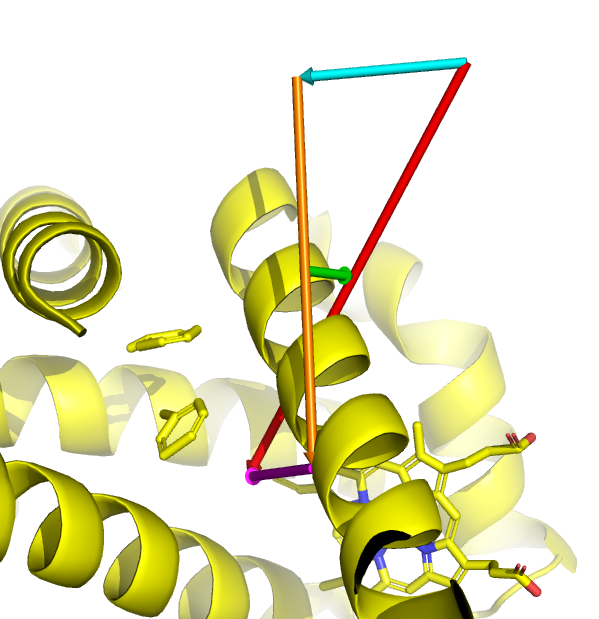

# overlay.py

**Rigid-body least-squares superposition of PyMOL objects, using selected atoms to define the fit.**

`overlay.py` finds equivalent fitting atoms in two PyMOL selections, calculates a Kabsch least-squares superposition, and applies the resulting rotation and translation to the **entire parent object** of the mobile selection. The target object is not moved.

The script supports protein C-alpha fitting and single-residue ligand heavy-atom fitting. It also writes an optional text report containing the transformation, RMSD, screw-axis information, and ready-to-paste CGO arrow commands.

## Requirements

PyMOL running under Python 3, with NumPy available in PyMOL's Python environment. No additional Python packages are required for the superposition. The optional cgo_arrow.py script is needed only for displaying arrows described in the report.


## Installation

1. Save or clone the repository on your computer.
2. Open PyMOL and load the molecular objects you want to compare.
3. In the PyMOL command line, run:

   ```pymol
   run /path/to/overlay.py
   ```

   Replace `/path/to/` with the actual location of the script. When the current working directory contains the file, `run overlay.py` is sufficient.

## Quick start

```pymol
# Fit protein selections; the full mobile_obj moves
select mobile_site, mobile_obj and chain A and resi 10-80
select target_site, target_obj and chain B and resi 10-80
overlay mobile_site, target_site

# Use positional correspondence when the residue numbers differ
# (only for a single protein chain per selection)
overlay mobile_site, target_site, mode=ordered

# Match named ligand heavy atoms in one ligand residue per selection
select moving_lig, mobile_obj and resn LIG
select fixed_lig, target_obj and resn LIG
overlay moving_lig, fixed_lig, mode=strict, report=ligand_fit.txt

# Suppress the report
overlay mobile_site, target_site, report=0
```

These are **illustrative commands**: replace object names, chain IDs, residue numbers and ligand names with those in your own session. In strict protein mode, corresponding residue numbers must agree.

## Command syntax

```text
overlay mobile, target [, mode=strict|ordered [, report=auto|0|filename]]
```

| Parameter | Meaning |
| --- | --- |
| `mobile` | Selection within the object that will be transformed |
| `target` | Selection within the fixed reference object |
| `mode=strict` | Default; protein correspondence by residue ID (and chain/segment for multichain), or ligand correspondence by atom name |
| `mode=ordered` | Single-chain protein only; pair sorted C-alpha atoms by position; equal counts required |
| `report=auto` | Default; write `overlay_<mobile-object>_onto_<target-object>.txt` in the working directory |
| `report=0` | Do not write a report (`off`, `none`, `no`, `false` also work) |
| `report=filename` | Write a report to the specified path |

## Matching rules and safeguards

**Proteins**

- Fitting uses selected `CA` atoms from PyMOL's `polymer.protein` classification (at least three).
- With one selected chain on each side, `strict` requires the same residue identifiers; chain letters may differ.
- With multiple selected chains, `strict` requires matching `(segment, chain, residue)` identifiers.
- `ordered` is available only for one chain per selection. It does not verify amino-acid sequence equivalence.

**Ligands and other supported non-protein selections**

- Fitting non-protein molecules uses non-hydrogen atoms, with exactly one residue in each selection.
- Atom names must be unique, and equal between selections.
- Only `strict` matching is supported.

**General limitations**

- Both selections must each belong to exactly one molecular object, and the objects must be different.
- Each object must have exactly one coordinate state.
- The fitting atoms must not be collinear or geometrically degenerate.
- This is a rigid fit with fixed atom pairs, not a sequence alignment, flexible fit, or iterative outlier rejection.
- If the selected atoms contain protein atoms, the selection is classified as protein, even if it also includes ligand atoms; only C-alpha atoms are used.
- The program computes the fitted RMSD mathematically before invoking PyMOL's object transformation. 

## Reports and visualisation

Unless disabled, a plain-text report includes:

- Selections, objects, molecule type, fitting mode, number of pairs, and fitted RMSD (angstroms)
- The rigid transform in `x_target = R @ x_mobile + t` convention
- A 3x3 rotation, 3-vector translation and 4x4 homogeneous matrix
- Screw rotation angle, rotation-axis direction and signed axial displacement where defined
- Optional `cgo_arrow` commands for displacement and screw-axis illustrations

The CGO commands printed in the report require the `cgo_arrow.py` script to be loaded in PyMOL. The overlay script does not automatically create these CGO arrows. Paste the commands into the PyMOL terminal to generate the arrows. In the report, `COM` means the unweighted centroid of the matched fitting atoms, not a mass-weighted molecular center of mass.
For a longer explanation and troubleshooting tips, see the PDF manual.

## Repository contents

```text
overlay.py
README.md
overlay_manual.pdf
```

## Illustration




